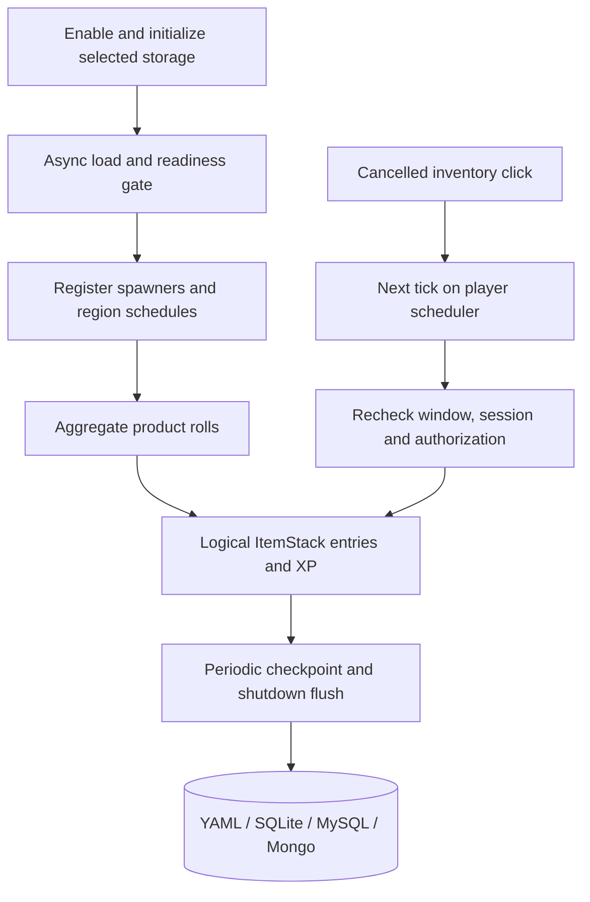
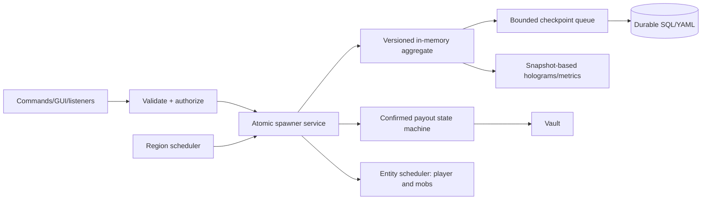

# Architecture — current state and target design

Reviewed against 1.4.0 on 2026-11-01 (storage: `StockEntry`/escrow model; see [VIRTUAL_STORAGE](features/VIRTUAL_STORAGE.md)). Future invariants below are acceptance goals, not universal runtime guarantees.

## Current source layout

| Module | Implemented responsibility | Remaining boundary |
| --- | --- | --- |
| `BravenSpawner.java` | Startup readiness, storage selection, async load, checkpoints and shutdown/reload | Live recovery and backend qualification |
| `manager/` | Per-spawner region schedules, authorized stacking, aggregated product output | Schedule churn, cross-region lifecycle and workload benchmarks |
| `model/Spawner.java` | Synchronized logical item entries, stack/tier, XP and revisions | Int counts; no exact-count vault or durable issuance ledger |
| `storage/` | YAML/SQLite/MySQL/Mongo, strict codecs, dirty SQL batches and schema v2 | Live MySQL/Mongo; cross-version migration qualification |
| `gui/`, `menu/` | Typed inventory sessions, authorization, confirmations; next-tick entity dispatch with session revalidation | Full player/Folia qualification |
| `boosters/`, `events/` | Typed timed effects, local booster ledger, calendar/weighted boost events | Timed gameplay events are not a public plugin event API |
| `econ/`, `sell/`, `commerce/` | Per-action currency providers, guarded settlement, optional shop adapters | Live provider outcomes and threading contracts |
| `mechanics/`, `holo/`, `listener/` | World/player interactions, hoppers, restoration and visuals | Remaining ownership/performance review |

## Current data flow

The shipped BSC2 item codec v2 stores an amount separately from an amount-one Paper item template and reads legacy streams. It does not replace the in-memory model with a `long` vault. GUI scheduling does not establish complete Folia ownership across all services.

## Proposed core invariants

1. **Single writer for every state mutation** per spawner: atomic reservation/release, revision/dirty marking and no overwriting concurrent storage snapshots.
2. **One task lease** per spawner ID and generation. Register, reschedule, unload and unregister are idempotent.
3. **Ownership first:** commands/listeners check actor, claims and item metadata before consuming boosters or changing counts.
4. **Correct world/thread locality:** region-owner block access, entity-owner player/mob access, async-only I/O.
5. **Explicit durability:** snapshots, journal/checkpoints, crash bounds, error propagation, migration safety.
6. **Confirmed settlement:** stock conservation plus external-economy result and reconciliation for indeterminate outcomes.
7. **Versioned compatibility:** server/JVM build matrix with runtime evidence, not just an API compile or `plugin.yml` marker.

## Target execution diagram

### Boot

`BOOTING → LOADING → READY`, or fail closed if storage cannot be loaded safely. Do not start tasks or accept mutations until authoritative state is ready. Settings are validated before publication.

### Production

Default virtual mode calculates bounded aggregate drops and XP without spawning an entity per virtual stack; opt-in physical mode obeys a strict region budget. Chunk unloads pause work unless explicit offline catch-up is enabled with quotas.

### Persistence

Dirty revisions are persisted incrementally and only acknowledged after durable commit. Failed records are quarantined; no silent empty inventory coercion. External economy payout cannot be made ACID with a local DB by assumption; use transaction state and reconciliation.

### Reload and shutdown

Cancel/update leases before rebuilding schedules. Drain and confirm scheduled writes during graceful shutdown with observable timeout/failure, never silently declare success.

## Implementation map

See [TECHNICAL_SPEC.md](TECHNICAL_SPEC.md) for target package boundaries, transaction protocols, metrics, API and tests; [ROADMAP.md](ROADMAP.md) for release order; [MIGRATION.md](MIGRATION.md) for backwards compatibility and rollback.
