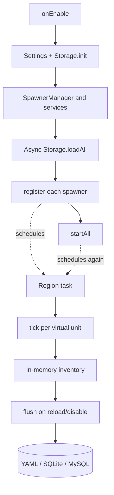
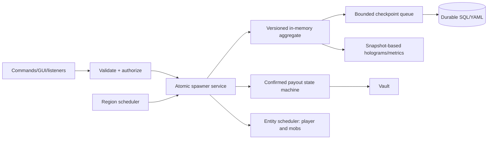
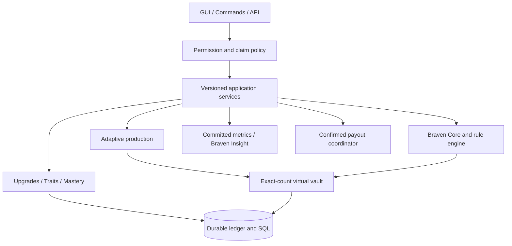

# Architecture — Current State and Target Design

**Source baseline:** `main` commit `90b39fce` (2026-10-30). This document explicitly separates **implemented code** from **target architecture**; statements in older revisions claiming universal Folia safety, immutable storage consistency and restart durability were not verified.

## Current source layout

| Module | Current responsibility | Observed gap |
| --- | --- | --- |
| `BravenSpawner.java` | Boot, storage selection, event/command registration, async load, shutdown flush | Load failure can fall back to empty list; no scheduled durable checkpoint |
| `manager/SpawnerManager.java` | Maps spawners and schedules per block | `register` and `startAll` both schedule; stack-sized production loop |
| `model/Spawner.java` | Identity, owner, trust, stored items, tier, XP | Some fields/collections synchronized, but multi-step workflows are not atomic |
| `storage/*` | YAML and SQL persistence, item codecs | SQL whole-table flush; write failure swallowed; silent corrupt decode |
| `gui/*` | Menu, paged inventory, lock timers | Session keyed by player, not proven inventory identity; external mutation races |
| `listener/*` | Placement, break, interaction, entity death, GUI guards | Incomplete authorization and PDC/stack invariants |
| `boosters/*` | Temporary multiplier maps | Legacy Bukkit scheduler in Folia-declared plugin |
| `sell/*` and `econ/*` | Pricing, autosell, Vault bridge, shop detection | Payout result unchecked; shop detection is informational |
| `mechanics/*`, `holo/*` | Hoppers, invisibility, mending, restoration, holograms | Several world/entity touchpoints need Folia ownership audit |

## Current data and scheduling flow

The double scheduling and lack of periodic checkpoint are **current defects**, not intentional design. See [AUDIT.md](AUDIT.md).

## Proposed core invariants

1. **Single writer for every state mutation** per spawner: atomic reservation/release, revision/dirty marking and no overwriting concurrent storage snapshots.
2. **One task lease** per spawner ID and generation. Register, reschedule, unload and unregister are idempotent.
3. **Ownership first:** commands/listeners check actor, claims and item metadata before consuming boosters or changing counts.
4. **Correct world/thread locality:** region-owner block access, entity-owner player/mob access, async-only I/O.
5. **Explicit durability:** snapshots, journal/checkpoints, crash bounds, error propagation, migration safety.
6. **Confirmed settlement:** stock conservation plus external-economy result and reconciliation for indeterminate outcomes.
7. **Versioned compatibility:** server/JVM build matrix with runtime evidence, not just an API compile or `plugin.yml` marker.

## Target execution diagram

### Boot

`BOOTING → LOADING → READY`, or fail closed if storage cannot be loaded safely. Do not start tasks or accept mutations until authoritative state is ready. Settings are validated before publication.

### Production

Default virtual mode calculates bounded aggregate drops and XP without spawning an entity per virtual stack; opt-in physical mode obeys a strict region budget. Chunk unloads pause work unless explicit offline catch-up is enabled with quotas.

### Persistence

Dirty revisions are persisted incrementally and only acknowledged after durable commit. Failed records are quarantined; no silent empty inventory coercion. External economy payout cannot be made ACID with a local DB by assumption; use transaction state and reconciliation.

### Reload and shutdown

Cancel/update leases before rebuilding schedules. Drain and confirm scheduled writes during graceful shutdown with observable timeout/failure, never silently declare success.

## Implementation map

See [TECHNICAL_SPEC.md](TECHNICAL_SPEC.md) for target package boundaries, transaction protocols, metrics, API and tests; [ROADMAP.md](ROADMAP.md) for release order; [MIGRATION.md](MIGRATION.md) for backwards compatibility and rollback.

## Advanced ecosystem integration (PROPOSED)

See [feature catalogue](features/FEATURE_CATALOG.md), [Production Engine](features/PRODUCTION_ENGINE.md), [Braven Core](features/BRAVEN_CORE.md), [Upgrade System](features/UPGRADE_SYSTEM.md) and [Public API](features/API_SPEC.md). The planned architecture uses independent bounded modules above a versioned spawner aggregate, virtual item vault and trusted operation coordinator:

The diagram is a **target**, not a verified runtime implementation. No cross-region world calls or unjournaled multi-vault changes are allowed.
