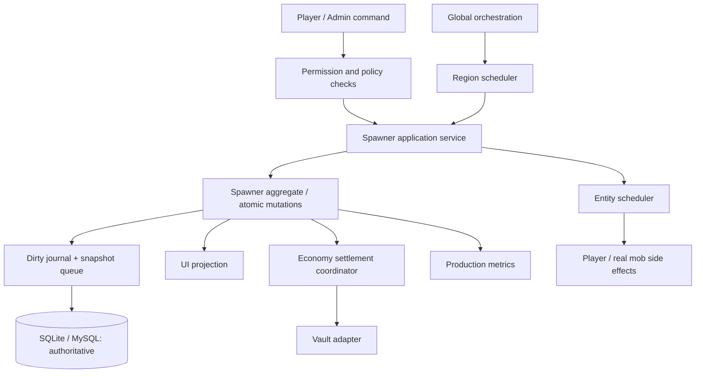

# Technical Specification — Proposed BravenSpawner Engine

**Status:** Design proposal, **not implemented** · **Baseline:** 2026-10-30 commit `90b39fce`.

## 1. System boundaries

The `Spawner` aggregate owns value and state; no GUI or listener may mutate storage directly after the service refactor. Cross-thread interactions move **identifiers/immutable snapshots**, not live Bukkit entities, inventory or `ConfigurationSection`.

## 2. Proposed packages

| Package | Responsibility |
| --- | --- |
| `api/` | Public read-only snapshots, actions, events, extension points |
| `domain/` | Spawner aggregates, policy, drop math, bounded numbers |
| `application/` | Place/stack/break/withdraw/sell/upgrade command handlers and authorization |
| `scheduler/` | Region, entity, async executors, lifecycle and task leases |
| `production/` | Virtual yield aggregation, physical mob budget, catch-up policy |
| `persistence/` | Schema migrations, dirty queue, journal, backend adapters, backups |
| `economy/` | Confirmed Vault settlement, idempotency, reconciliation |
| `integration/` | Optional shop, claims, MythicMobs, PlaceholderAPI adapters |
| `presentation/` | Identity-safe GUI holders, holograms, player messages |
| `diagnostics/` | Counters, trace points, admin inspect and audit trail |

These names are a target refactor; existing package names need not change in the hotfix.

## 3. Scheduling and ownership contract

1. Use `RegionScheduler` to access the target block/chunk/world and to run the spawner's production command. Never force-load chunks in a periodic pass.
2. Use `EntityScheduler` for player messaging, inventory, teleports and live mob state.
3. Use `GlobalRegionScheduler` only for plugin-global orchestration that does not read/mutate foreign-region world/entity state.
4. Use `AsyncScheduler` or bounded dedicated executor for JDBC/YAML I/O and pure computation.
5. Maintain exactly one `TaskLease` per spawner UUID. `register`, `reschedule`, `unregister` and shutdown are idempotent. Schedule on initial load **once**, not during both registration and start-all.
6. Hot reload is a staged operation: validate new immutable settings, stop/rebuild eligible schedules once, swap config, preserve active transitions and audit outcome.
7. Track active/unloaded world state; region tasks must revalidate registration generation and chunk availability before mutation.

### Lifecycle

`BOOTING → LOADING → READY → DRAINING → STOPPED`; if a storage load fails, transition to `FAILED_READ_ONLY`/disabled, **never** begin from an empty map and overwrite the database. Commands that mutate state are refused until `READY`.

## 4. Canonical value and anti-dupe model

**State invariants:**
- `spawner.stack >= 1` for active placed producers; stack count on a physical item is separate from `ItemStack.amount` and bounded.
- `world+block position` uniquely maps to at most one producer; UUID maps to exactly one record.
- For any successful transfer, `before = after + delivered + paid-for` in the relevant unit (items, XP or virtual producers).
- Failed authorization, failed inventory transfer, unconfirmed payout and stale session **do not change state**.
- Storage mutation is serialized per producer with a `revision` number. `getSnapshot()` is immutable and internally consistent.
- PDC data is validated against signed/registered issued items or another explicit trusted-item policy; stale/unknown identifiers fail closed.

**Operation pattern:**
`validate(request, actor, location, item) → reserve or mutate under aggregate lock → execute world/player effect on owning scheduler → commit or compensate → markDirty/revision++ → acknowledge`.

No lock is held across an asynchronous remote economy call. Operations that cannot be atomically combined with an external provider use a **durable pending transaction** with idempotent reconciliation rather than claiming full ACID semantics across Vault and SQL.

Inventory transfers to player/hopper must account for actual accepted amount; rejected remainder stays in the aggregate/escrow. Inventory close/page changes cannot trigger multiple concurrently valid GUI sessions: identify every open inventory by typed holder + session generation + viewed inventory UUID; reject old events and drag/number-key paths.

## 5. Virtual production

`VIRTUAL_LOOT` executes at most one bounded production calculation per due spawner; an individual physical mob is not spawned for every virtual stack. For drop `amount` with independent per-unit chance `p`, calculate aggregate trial count `n = cycles * stack * amount` with an exact binomial or well-documented approximation with error limits, rather than `n` individual random calls. For deterministic drops `p=1`, multiply with checked integer arithmetic. Preserve existing config semantics and XP accounting.

- Use `long` checked/saturating arithmetic with configurable hard caps and explicit overflow reporting.
- Chunk/world indexes avoid repeated full scans in hot paths.
- Prefer spatially bounded lookup to `world.getNearbyEntities` for every virtual producer; calculate physical mob quotas once per relevant region/pass.
- Introduce per-region budgets for expensive work and a fair backlog policy.
- Limit offline catch-up by elapsed time, maximum cycles, owner rules and storage capacity; choose `SKIP` as safe default until fully implemented.
- Persist production phase/deadline or last-processed time carefully; no automatic double catch-up after clock changes/restart.
- Distinguish `VIRTUAL_LOOT` and `PHYSICAL_MOB` in metrics; the two modes may not promise identical drops if real mob death, looting and player kill constraints differ.

## 6. Database and checkpoint strategy

**Current:** `Storage`, `SqlStorage`, `YamlStorage` use whole-map flush; SQL deletes all rows on flush; in-memory state can drift from persisted state after a crash.

**Proposed:**
- `schema_version` and forward-only migrations with reversible backup procedures.
- `spawners` table uses primary UUID, unique world/block key, owner index, `revision BIGINT`, `updated_at`; preserve old fields via additive migration.
- `spawner_inventory` uses a versioned bounded serialization format; quarantine invalid blobs. Hard-limit item count/payload length, reject invalid object types and report precise errors.
- `spawner_operations` / `payout_ledger` carry operation UUID, state (`PENDING`, `CONFIRMED`, `COMPENSATING`, `FAILED`), amount, idempotency key and timestamps.
- Dirty snapshot queue is bounded and coalesced by spawner ID. Flush asynchronously with parameterized batch UPSERT and revision check; retry with backoff, surfaced health metric and refusal of writes when durability guarantee cannot be met.
- SQLite WAL for single-server deployments; MySQL for external database. Redis is **not** authoritative and is not a replacement for durable transactions.
- Never delete all rows after partial/failed load. DB outage yields read-only or controlled-degraded mode, not silent success.
- A durable batch is acknowledged only after successful transaction commit; on graceful shutdown drain with bounded timeout and report incomplete writes.
- YAML mode is supported for small servers only, via temp file + `fsync` + atomic move where supported, with explicit error propagation.

## 7. Economy settlement

1. Quote from immutable priced inventory snapshot; validate finite non-negative unit prices and multipliers.
2. Reserve exact stock under producer lock using an operation UUID; persisted reservation prevents another buyer/hopper/producer from consuming the same stock.
3. Submit payout to Vault on an API-safe context; inspect `EconomyResponse.transactionSuccess()` (including failed/partial reports).
4. Mark confirmed payout and consume reservation **once**; on failure release reservation; on unknown outcome quarantine as `PENDING_RECONCILIATION` and require operator handling if provider has no idempotent lookup.
5. Never claim exactly-once external payout unless the chosen economy provider supplies idempotent settlement or reconciliation guarantees.
6. Ensure automated sales are not executed from foreign-region threads for player-affecting operations.

## 8. Validation, observability and hooks

- Config schema version, bounds and default semantics; fail startup when core paths are invalid.
- Safe item type/kind parsing (`valueOf` guarded), configured product existence checks, amount limits, permissions and claim adapters before consuming resources.
- Metrics: `active_spawners`, `scheduled_tasks`, `pending_flushes`, `flush_errors`, `sale_pending`, `production_cycles`, `region_work_ns`, `physical_mobs`.
- Logs include operation UUID and spawner UUID, never database passwords.
- `/bspawner diagnose` and `/bspawner stats` are proposed; no claim they work today.
- Public API methods return snapshots and futures/results, not mutable internal `Spawner` objects.
- Dependabot upgrades require compatible Java runtime and Paper API target. Maintain version-pinned build matrices.

## 9. Engineering tests required

Unit/property: inventory conservation, count round-trip, bounds, probability aggregation, policy decisions, snapshot consistency.

Integration: SQLite and MySQL migrations, partial-load fail-close, injected transaction failure, canceled GUI interactions, Vault provider outcomes, lifecycle scheduling, backup/restore.

Runtime: Paper and Folia exact supported build(s), separate region load/unload, movement/teleport across regions, hopper and hologram cleanup, simultaneous actions and crash recovery.

See [TESTER_OWNER.md](TESTER_OWNER.md).
