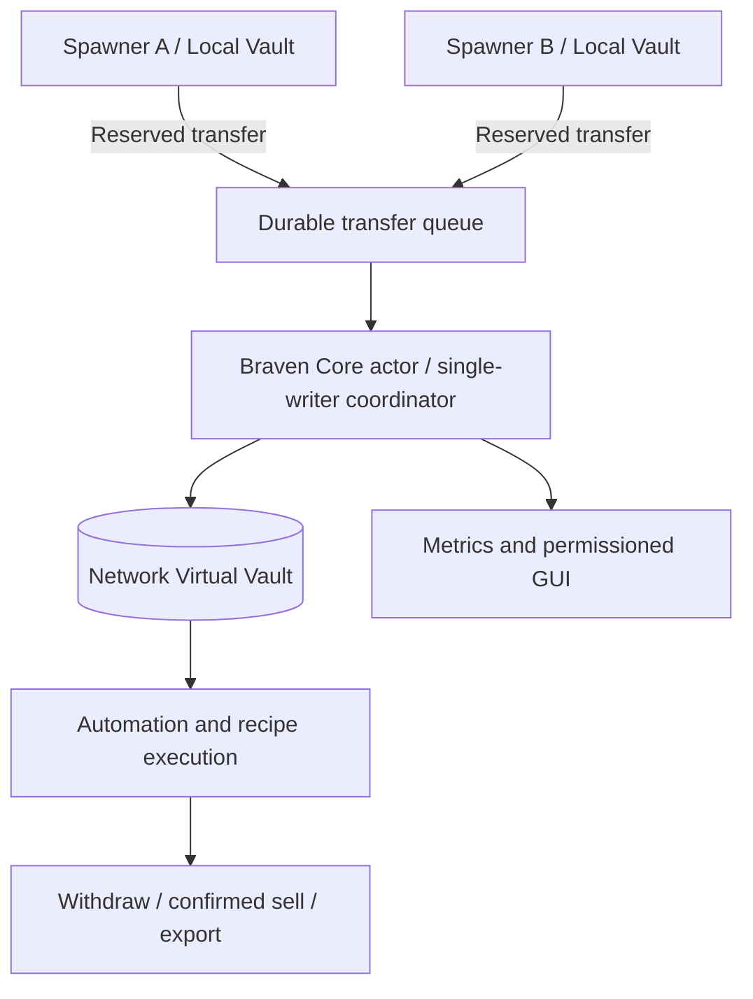

# Braven Core — Controller, Network & Synergy — NET-01

**Status: PROPOSED**. Braven Core is a virtual production controller, not a license to mutate any storage on another Folia region directly.

## 1. Concepts

- **Core:** a controller UUID, owner/team, position (optional physical block), versioned settings and resource quotas.
- **Node:** a placed spawner group attached by explicit authorization to one controller at a time.
- **Local Vault:** per-producer inventory; source of record before a confirmed network transfer.
- **Network Vault:** controller-owned authoritative virtual inventory with a bounded key/item capacity.
- **Edge:** permissioned routing between a node and controller; can be `ACTIVE`, `PAUSED`, `UNLOADED`, `PENDING`, `FAULTED`.
- **Recipe:** a configured multi-resource transformation; synergy is a versioned recipe/effect, not passive unlimited multiplicative yield.

## 2. Player features

1. Create/claim Braven Core and connect/disconnect permitted spawners.
2. View network overview (nodes, input/output rates, storage/capacity, processing queue, pending errors, controller tier).
3. Route outputs: `KEEP_LOCAL`, `SEND_TO_CORE`, `SELL_CONFIRMED`, `PROCESS`, `PAUSE`.
4. Install controller modules: advanced filters, prioritized transport, storage compression, price adapters, configured synergy and rule slots.
5. Manage team roles with separate connect, configure, withdraw, sell, upgrade and dismantle permissions.
6. Optionally link a network hopper/exporter; never create physical item entities for bulk transfers.

## 3. Synergy examples

| Inputs | Proposed recipe | Cost/limit |
| --- | --- | --- |
| Blaze Rods + Iron Ingots | `SMELTING_SYNERGY` to process eligible iron recipes | Consumes actual input counts; bounded processing per pass |
| Bone + Wheat | `FARM_SYNERGY` to refine agricultural outputs | Recipe-defined consumption; no free duplication |
| Multi-category network | `DIVERSITY_BONUS` limited throughput bonus | Max benefit + soft cap; counted per compatible distinct node, not stack units |

All examples are **game design proposals** and must be balanced. Synergy activation should not modify vanilla mob drops unless an explicit, documented hook approves it.

## 4. Architecture



A server-authoritative controller actor serializes virtual-vault mutation. Node event traffic is chunk-indexed and coalesced. Network updates are delivered as ID/snapshot messages, not live Bukkit `ItemStack`, player or block state. All physical block, hopper and player effects return to owning region/entity scheduler.

## 5. Transfer protocol

`NEW → SOURCE_RESERVED → DESTINATION_ACCEPTED → SOURCE_COMMITTED → COMPLETE`, with durable operation ID and source/destination revision. On retry, the same ID cannot increment destination twice. If destination is full, **release reservation** or keep a retryable local queue; never void.

A cross-vault transfer on a single SQL database can use one DB transaction for stock decrement/increment and ledger write. With multiple owners or servers, do **not** assume ACID; use explicit escrow/fencing and fail closed on partition. The first version must be **same-server only**, unless a later feature passes multi-server split-brain tests.

## 6. Controller & network limits

- Max nodes per controller, max total virtual producer units, maximum distinct network stock keys, throughput/cycle, pending operations, controllers per island/owner.
- Index node membership by controller and chunk, update on place/break/reassign; avoid full-world scans every tick.
- Dormant/unloaded node: mark as inactive; no forced chunk loading.
- Controller removed: safe unlink policy. Existing local vaults remain; network vault stock goes to an admin-recoverable durable claim inbox or requires explicit transfer before dismantle.
- Offline owner policy, bankruptcy/fuel shortage, corruption and redstone disable are explicit configuration options.
- Network graph is for coordination and visual grouping, not a requirement to pathfind through blocks every tick.

## 7. Permission model

| Role | View | Configure rules | Connect nodes | Withdraw | Upgrade | Dismantle |
| --- | --- | --- | --- | --- | --- | --- |
| OWNER | Yes | Yes | Yes | Yes | Yes | Yes |
| MANAGER | Yes | Yes | Yes | Optional | Optional | No |
| OPERATOR | Yes | Limited | Limited | No by default | No | No |
| WITHDRAWER | Yes | No | No | Yes | No | No |
| VIEWER | Yes | No | No | No | No | No |

Permissions must also respect claim plugins and server-world limits at execution time. A trusted member in one spawner does not automatically own the whole network.

## 8. Example config (not shipped)

```yaml
braven-core:
  enabled: false
  same-server-only: true
  max-nodes-per-core: 128
  max-virtual-units-per-core: 1000000
  max-items-transferred-per-second: 100000
  max-pending-transfers: 5000
  on-core-destroy: BLOCK_UNTIL_VAULT_EMPTY
  overflow: KEEP_LOCAL
```

## 9. Acceptance tests

- 2/100 active nodes feeding one vault maintain exact conserved counts.
- Claim revocation during pending transfer prevents unauthorized new operations and safely reconciles already-reserved stock.
- Unload / reload distant Folia regions and break a linked node during processing without wrong-thread exceptions.
- Full network vault does not lose local loot; rollback and retry never double-credit.
- Core deletion with stock refuses or produces a fully auditable recovery operation.
- Network metrics scale with active/changed nodes, not every possible pair in the graph.
