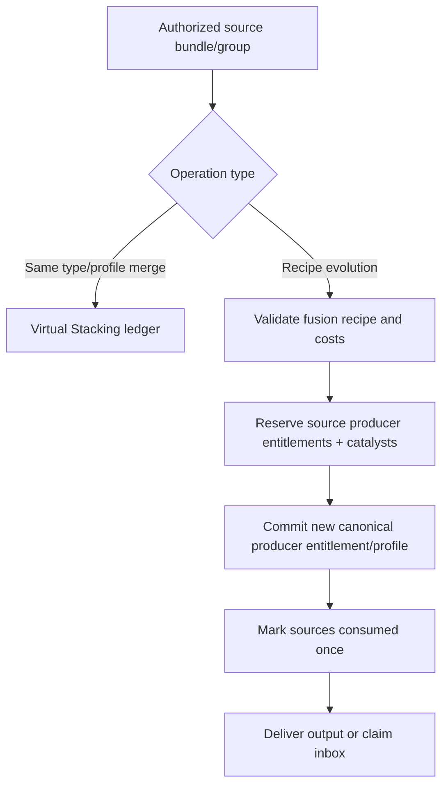

# Genome, Fusion, Evolution, Specialization & Prestige — EVOL-01

> **Proposal — not scheduled; depends on 1.4.0/1.5.0.** Moved from PR #7; see the [feature catalogue](../FEATURE_CATALOG.md) and [roadmap](../../ROADMAP.md).

**Status: PROPOSED**. All special traits and prestige are optional gameplay systems, never prerequisites for safe base storage.

## 1. Vocabulary

- **Genome:** deterministic, versioned set of trait slots on a compatible producer profile; not a biological or AI mechanic.
- **Trait:** one bounded modifier or capability (e.g. Rapid, Efficient, Fortunate, Stable). Traits can be acquired by earned blueprints/catalysts or randomized only within disclosed odds.
- **Fusion:** a controlled recipe consuming producer entitlements/materials to create an upgraded entitlement/profile; **not** generic same-type stacking.
- **Evolution:** unlocks a higher named stage after milestones and documented costs, granting configurable trait slots/capabilities.
- **Specialization:** mutually constrained path: Industrial, Prospector or Automator; path-specific upgrade limits and effects.
- **Prestige / Rebirth:** voluntary late-game progression reset/exchange with explicit kept/lost state, never an implicit wipe.

## 2. Suggested trait system

| Trait | Description | Guardrail |
| --- | --- | --- |
| `RAPID` | Faster eligible production | Minimum interval and region work budget |
| `FORTUNATE` | Additional bounded bonus trials | Global expected yield cap |
| `EFFICIENT` | Lower configured fuel/catalyst consumption | Fuel minimum & non-negative arithmetic |
| `STABLE` | Lower optional corruption/overheat risk | No absolute immunity unless server opts in |
| `STORAGE_SAVANT` | Expand virtual capacity/distinct keys | Hard vault byte/item count limits |
| `SYNCED` | Network throughput / low-overhead controller effects | Explicit throughput caps |

Traits have `trait_id`, `version`, `level`, `source_operation_id` and an immutable compatible-profile fingerprint. Avoid adding an unbounded trait list into item PDC; authoritative versioned persisted entitlement stores traits.

## 3. Specialization paths

**Industrial:** predictable production, speed and throughput, with high fuel demands or less rare output.

**Prospector:** bonus rare materials and refinement efficiency with stricter bonus probability cap; never unrestricted high-tier drops.

**Automator:** rule slots, transfer and auto-processing efficiency, with lower maximum raw-speed benefit than Industrial.

Specializations must have trade-offs; a path does not automatically grant every other path's bonuses. Allow changing paths only through controlled respec with validated payment and safe handling of incompatible modules.

## 4. Fusion vs stacking

Use exact input-output entitlements and idempotent operation IDs. Never consume two groups with distinct vault contents without an explicit per-source vault migration/ownership agreement; contents/XP remain linked to recorded vault or are transferred through atomic/escrow accounting.

Fusion must not grant duplicate mastery XP or research counters when repeated via split/remerge. If the destination inventory is full, output enters a durable claim inbox; do not drop huge stacks into the world.

## 5. Evolution and prestige progression

Example (balance *illustration*):

| Stage | Unlock | Requirements |
| --- | --- | --- |
| Base | First tier upgrades | Initial spawner |
| Refined | Trait slot I | Mastery and research requirement |
| Enhanced | Specialization slot | Crafted catalyst and challenge |
| Ascendant | Synergy recipes | Network/research milestone |
| Prestige I | Cosmetic/selected permanent passive | Endgame mastery + explicit reset choice |

The server must show a before/after report: producer units, tier/upgrade effects, traits, vault contents/XP, mastery points, controller memberships, catalysts and currency. Explicitly state which data is retained, transformed, reset or unavailable after the operation. **Default:** owner, vault inventory, XP, issued bundle lineage and block coordinates remain unchanged by prestige. If an admin config enables a destructive reset, require confirmation and backup.

Prestige rewards should emphasize horizontal progression, cosmetic identity or narrowly capped specialization rather than infinite multiplicative production power. Offer a no-prestige path to core game features.

## 6. Genome rarity policy

If trait rolls exist, published server-configured odds must be displayed and validated. Avoid combining paid real-money mechanisms and undisclosed random odds. Random result is generated server-side, persist the operation/result before delivery, and ensure disconnect/retry never rolls again for the same paid action.

Trait rerolls consume a bounded catalyst and respect a pity/guarantee design only if configured; publish exactly how it works. A derived item fingerprint must include genome profile version when checking merge compatibility.

## 7. Economy & technical controls

- Max levels, number of active traits, synergy slots and combined production bonus are configurable with mandatory technical caps.
- Require specialization/trait compatibility before merge, shared network membership changes and upgrade purchase.
- Persist all transformations as versioned, append-only operation records; backup/migration can reconstruct the final profile.
- Folia: world mutations schedule on owning region; player inventory delivery schedules on player entity; remote service steps must never block region thread.
- Include admin inspect and dry-run recipe preview; never expose raw PDC as sole authority.

## 8. Acceptance

- Two concurrent fusion operations cannot consume a source entitlement twice.
- Incompatible trait profiles cannot merge via generic stacking.
- Full inventory/disconnect routes new items to a durable claim inbox without duplication.
- Prestige cannot erase vault/XP by surprise; confirmed kept/reset state matches summary.
- Trait odds and bonuses obey configured caps, including after stacking, buffs, offline production and reload.
- Backup/rollback preserves old profiles and marks unknown genome versions for manual review.
