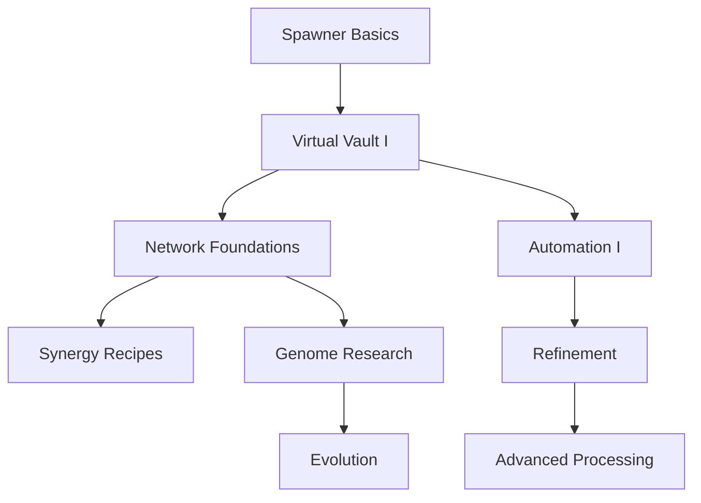

# Mastery, Research, Blueprints, Contracts & Achievements — PROG-01

> **Proposal — not scheduled; depends on 1.3.0/1.4.0.** Moved from PR #7; see the [feature catalogue](../FEATURE_CATALOG.md) and [roadmap](../../ROADMAP.md).

**Status: PROPOSED.** Optional progression layer designed for SkyBlock/OneBlock endgame and server-specific quests.

## 1. Player progression layers

| Layer | Earned by | Unlock examples | Is it lost on split? |
| --- | --- | --- | --- |
| `SpawnerMastery` (per stable group lineage) | Credited meaningful production, upgrades and challenges | Trait slot, unique cosmetic | No |
| `PlayerResearch` (per player/account) | Completing goals and consuming authorized research materials | Network, refining, trait recipes | No |
| `BlueprintLibrary` (per owner/team) | Crafted/unlocked recipe IDs | Automation modules, specializations | No |
| `Contracts` (time-bounded objectives) | Delivered virtual stock to audited sinks | Currency, research points or catalyst | N/A |
| `Achievements` | Single-use milestone completion | Cosmetic/title/one-time bonus | N/A |
| `Prestige` | Voluntary capped endgame exchange | Horizontal progression/rare slot | Explicit policy |

Do not credit a mastery point per physical tick or per stack entry; count eligible **production activity with abuse-resistant caps**. Spawner group splits/merges retain lineage counters; repeatedly splitting, merging, breaking or restoring cannot retrigger first-time milestones.

## 2. Research tree (illustrative)



Research nodes use unique ID/version, requirements `prerequisiteIds`, exact sink costs, objective progress and scope (`PLAYER`, `ISLAND`, `SERVER`). Reject cycles, unavailable predecessors and negative costs. Completing research changes a versioned unlocked flag, not a mutable UI item.

## 3. Contracts and delivery

- Contract type: `DELIVER_MATERIAL`, `PRODUCE_DIVERSE_ITEMS`, `MAINTAIN_EFFICIENCY`, `PROCESS_RECIPE`, `OPERATE_NETWORK`.
- **Delivery contracts consume actual virtual stock** through VaultService and grant a confirmed durable completion receipt.
- Passive contracts track authoritative aggregates with eligibility windows and caps (e.g., do not count repeatedly moving the same item between vaults as newly produced).
- An owner can choose daily/weekly contracts or server-managed seasons; times are absolute epoch and timezone semantics defined.
- Failed or expired contract does not consume more stock; retry uses the same operation ID.
- No gambling-like mandatory paid rerolls and no rewards that bypass economy caps.

## 4. Blueprints and modules

Blueprints may unlock recipes or permit the crafting of a module; they are not identical to a physical modifiable `ItemStack`. Keep recipe version and ownership record separate from display item lore. A module may specify compatibility (controller or producer), minimum specialization, max copies and safe effect caps. Removal returns a module entitlement only once, with durability/upgrade state per explicit policy.

## 5. Mastery reward policy

- XP/points are deterministic and rate-limited, derived from actual producer output and meaningful goals, **not from selling and rebuying the same stock repeatedly**.
- Separate owner/account mastery from spawner lineage mastery to prevent break/recreation exploits.
- Do not tie all game functionality to prestige; basic gameplay remains accessible.
- Admins configure progression pace and can disable module independently with policy for already-unlocked entitlements.
- Prestige has clear retained/reset data and user confirmation as detailed in [Evolution](EVOLUTION.md).

## 6. Suggested data model

```text
research_progress(scope_id, node_id, node_version, progress, status, completed_at)
blueprint_unlocks(scope_id, blueprint_id, version, granted_op_id)
mastery_state(lineage_id, owner_id, points, level, revision)
contract_instances(contract_id, scope_id, deadline, progress, status, receipt_id)
claim_receipts(operation_id, reward_type, amount, state, claimed_at)
```

All grants are idempotent; unknown versions are quarantined until migration or manual decision.

## 7. Acceptance

- Research graph validates acyclicity and missing dependencies before server startup/config reload.
- Duplicate contract delivery attempts consume stock and grant rewards at most once.
- Split/merge/restore/fusion cannot reset one-time reward eligibility.
- Offline credit cannot exceed caps or claim impossible production.
- Timezone/restart/clock adjustments cannot trigger repeat daily or weekly milestones.
- Disabled modules retain readable safe records for future re-enable or documented refund.
